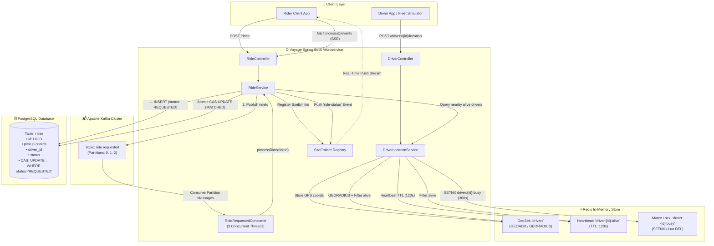
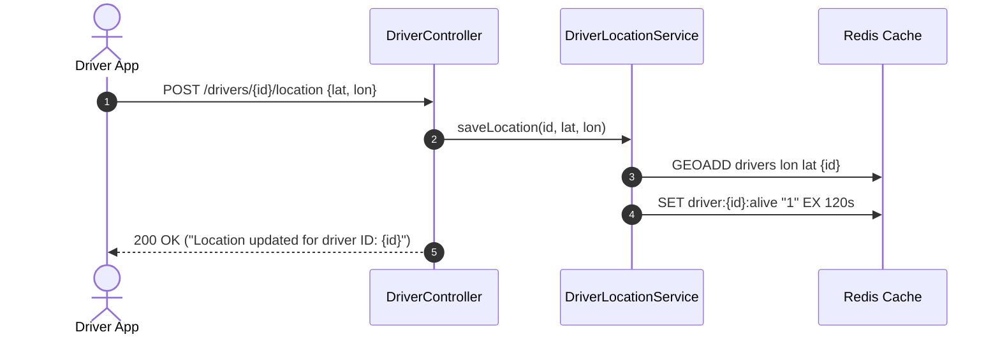
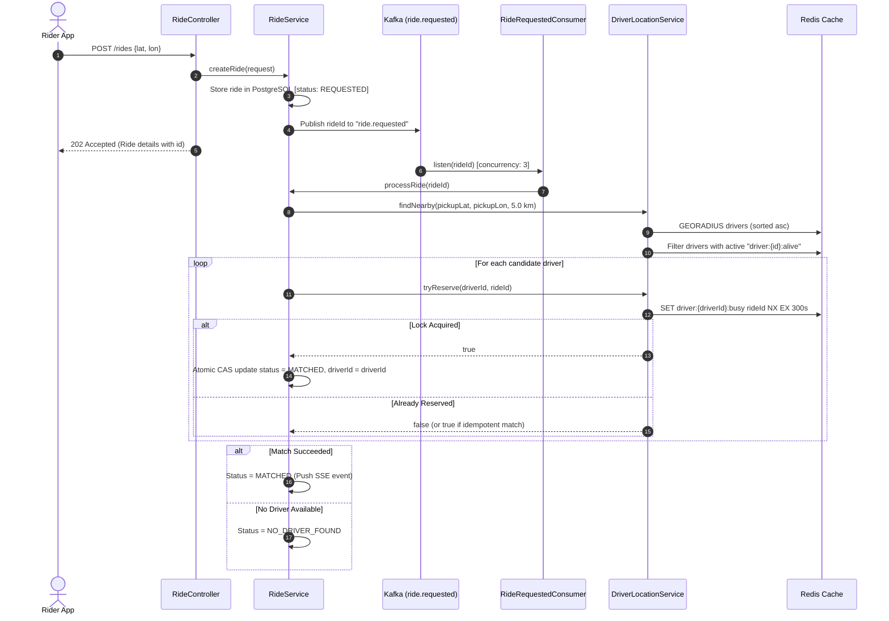
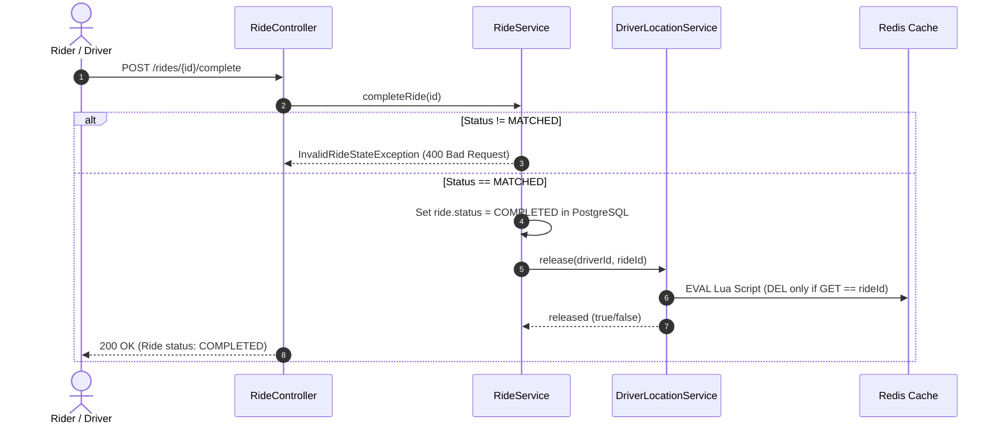
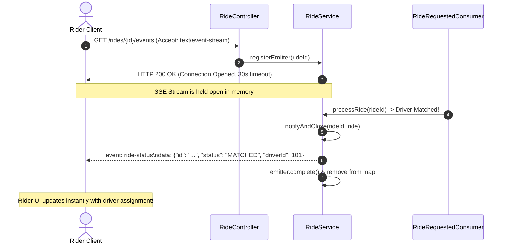
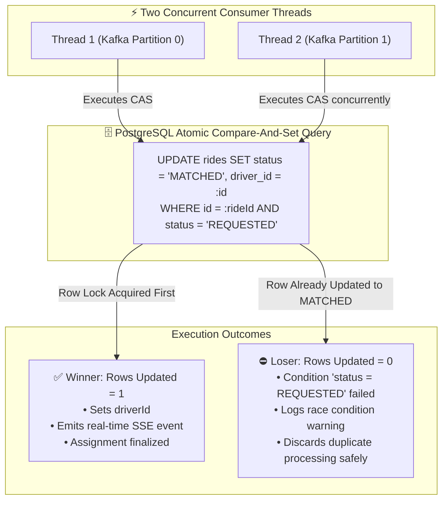
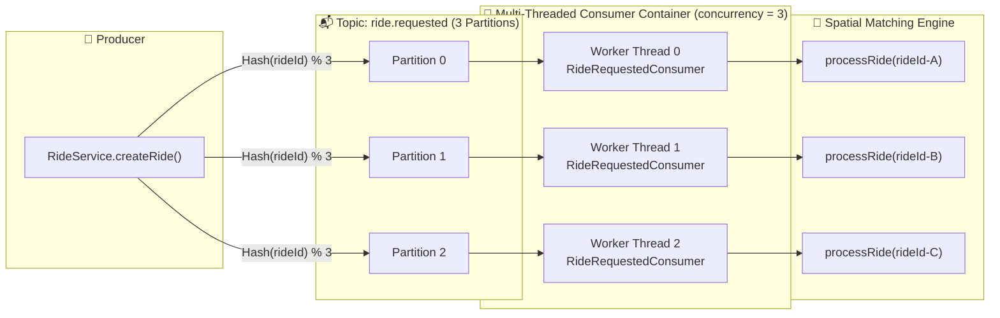
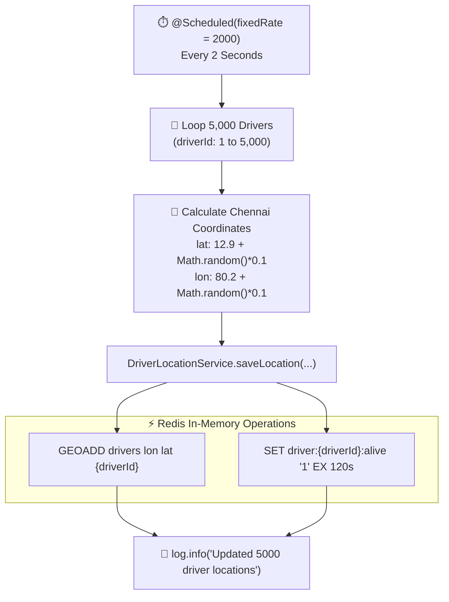
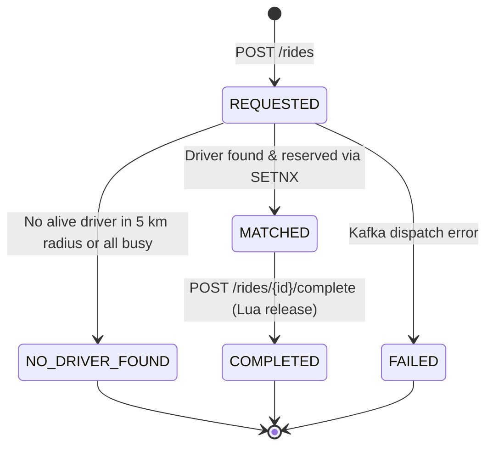

# 🚗 Voyage — Distributed Real-Time Ride Matching Service

[](https://openjdk.org/)
[](https://spring.io/projects/spring-boot)
[](https://www.postgresql.org/)
[](https://kafka.apache.org/)
[](https://redis.io/)
[](https://maven.apache.org/)

> 📖 **Deep Dive Documentation Suite**: Comprehensive, interview-ready documentation for all system design modules, PostgreSQL integration, Redis geospatial locking, Kafka concurrency, Driver Simulation, and Load Testing is available in the **[`docs/`](./docs/README.md)** directory.

**Voyage** is an ultra-high-throughput, event-driven ride-matching microservice engineered with **Java 21**, **Spring Boot 4**, **Apache Kafka**, **Redis**, and **PostgreSQL**. Modeled after the production backends of ride-hailing platforms like **Uber, Lyft, and Grab**, Voyage solves core distributed systems challenges: sub-millisecond geospatial driver discovery, heartbeat liveness tracking, double-booking prevention via distributed mutex locks, atomic Lua-based lock release, asynchronous event ingestion with multi-threaded Kafka consumers, durable ACID persistence with optimistic Compare-And-Set (CAS) transitions, real-time Server-Sent Events (SSE) streaming, and autonomous driver GPS fleet simulation.

---

## 📑 Table of Contents

- [📚 Complete Documentation Suite (`docs/`)](#-complete-documentation-suite-docs)
- [⚡ Key Architectural Highlights](#-key-architectural-highlights)
- [🏗 System Architecture & Flows](#-system-architecture--flows)
  - [System Topology Overview](#system-topology-overview)
  - [1. Driver Location & Liveness Heartbeat](#1-driver-location--liveness-heartbeat)
  - [2. Asynchronous Ride Matching Flow](#2-asynchronous-ride-matching-flow)
  - [3. Ride Completion & Safe Driver Release](#3-ride-completion--safe-driver-release)
- [🛠 Technology Stack & Polyglot Persistence](#-technology-stack--polyglot-persistence)
- [📁 Project Directory Structure](#-project-directory-structure)
- [📡 REST & Real-Time API Reference](#-rest--real-time-api-reference)
  - [Driver Endpoints](#driver-endpoints)
  - [Ride Endpoints](#ride-endpoints)
  - [Real-Time Server-Sent Events (SSE) Flow](#real-time-server-sent-events-sse-flow)
- [🗄️ PostgreSQL Persistence & Optimistic CAS Locking](#️-postgresql-persistence--optimistic-cas-locking)
  - [Database Schema (`rides`)](#database-schema-rides)
  - [Atomic Compare-And-Set (CAS) Concurrency Flow](#atomic-compare-and-set-cas-concurrency-flow)
  - [Polyglot Storage: PostgreSQL vs. Redis](#polyglot-storage-postgresql-vs-redis)
- [🔒 Redis Data Structures & Distributed Locking](#-redis-data-structures--distributed-locking)
  - [Key Architecture & TTLs](#key-architecture--ttls)
  - [Distributed Reservation (`SETNX`)](#distributed-reservation-setnx)
  - [Atomic Release via Redis Lua Script](#atomic-release-via-redis-lua-script)
  - [Idempotent Redelivery Protection](#idempotent-redelivery-protection)
- [📬 Kafka Event Pipeline & Consumer Concurrency](#-kafka-event-pipeline--consumer-concurrency)
  - [Partition-to-Consumer Topology](#partition-to-consumer-topology)
- [🚗 Background Driver GPS Fleet Simulator](#-background-driver-gps-fleet-simulator)
  - [Fleet Simulation Flow](#fleet-simulation-flow)
- [🔄 Ride Lifecycle & State Machine](#-ride-lifecycle--state-machine)
- [🧪 Concurrency, Integration & Load Testing](#-concurrency-integration--load-testing)
  - [1. Concurrency Race Testing (1,000 Threads)](#1-concurrency-race-testing-1000-threads)
  - [2. High-Throughput HTTP Load Benchmark](#2-high-throughput-http-load-benchmark)
- [🚀 Getting Started](#-getting-started)
  - [Prerequisites](#prerequisites)
  - [Quick Infrastructure Setup via Docker](#quick-infrastructure-setup-via-docker)
  - [Application Configuration](#application-configuration)
  - [Running the Application](#running-the-application)
  - [Running the Load Benchmark](#running-the-load-benchmark)
  - [Running the Test Suite](#running-the-test-suite)
- [👤 Author](#-author)

---

## 📚 Complete Documentation Suite (`docs/`)

For in-depth explanations, mathematical derivations, step-by-step guides, and interview prep, check out the dedicated technical documentation in [`docs/`](./docs/README.md):

| Guide | Focus Area & Description |
| :--- | :--- |
| **[01. System Architecture & Flows](./docs/01-architecture-and-system-design.md)** | End-to-end architecture, API contracts, async message lifecycles, and detailed sequence diagrams. |
| **[02. Database & PostgreSQL Integration](./docs/02-database-and-postgresql.md)** | Transition from in-memory to PostgreSQL, schema design, JPA configuration, and atomic Compare-And-Set (CAS) queries. |
| **[03. Redis Geospatial & Distributed Locking](./docs/03-redis-geospatial-and-distributed-locking.md)** | `GEOADD`/`GEORADIUS` spatial indexing, 2-minute heartbeat keys, `SETNX` distributed locking, and atomic Lua script release. |
| **[04. Kafka Event Streaming & Concurrency](./docs/04-kafka-event-streaming-and-concurrency.md)** | Topic partitioning, multi-threaded consumer concurrency, offset management, retries, and consumer backpressure. |
| **[05. Driver Simulation Guide](./docs/05-driver-simulation-guide.md)** | Autonomous fleet simulation (`DriverSimulator`), `@Scheduled` execution, real-world coordinate generation around Chennai. |
| **[06. Load Testing & Benchmarking](./docs/06-load-testing-and-benchmarking.md)** | Stress-testing with 1,000 requests across 100 concurrent worker threads, latency percentiles, and system throughput. |
| **[07. Complete File & Module Reference](./docs/07-complete-file-and-module-reference.md)** | File-by-file inspection of every controller, service, repository, model, DTO, exception, and configuration bean. |
| **[08. Interview Cheat Sheet & Q&A](./docs/08-interview-cheat-sheet-and-qa.md)** | Ready-to-use 2-minute elevator pitch, distributed systems Q&A (double-booking, split-brain, polyglot storage tradeoffs). |

---

## ⚡ Key Architectural Highlights

- **Spatial Indexing with Redis Geospatial**: Uses Redis Geospatial sorted sets (`GEOADD`, `GEOPOSITION`, `GEORADIUS`) to index driver coordinates and fetch the nearest available drivers within radial constraints in sub-millisecond latency.
- **Heartbeat-Driven Driver Liveness**: Driver coordinate pings populate an ephemeral heartbeat key (`driver:{id}:alive`) with an automatic 2-minute TTL. The matching engine dynamically filters out stale or offline drivers.
- **Decoupled Asynchronous Ingestion via Apache Kafka**: Ride requests return HTTP `202 Accepted` immediately upon creation and publish to a partitioned `ride.requested` Kafka topic, completely insulating API callers from spatial search query latency.
- **Multi-Threaded Consumer Concurrency**: Kafka consumers process rides concurrently across topic partitions using Spring Kafka's multi-threaded listener container (`concurrency = "3"`).
- **Durable ACID Persistence with PostgreSQL**: All ride records, historical statuses, driver allocations, and audit timestamps are durably persisted in PostgreSQL via Spring Data JPA, ensuring zero data loss upon server restart.
- **Atomic Compare-And-Set (CAS) State Transitions**: Prevents race conditions during matching through database-level conditional updates (`UPDATE rides SET status = 'MATCHED' WHERE id = :id AND status = 'REQUESTED'`). Only one concurrent thread can win the state transition.
- **Distributed Mutex Lock with Safety TTL**: Prevents double-booking where multiple concurrent rides compete for the same closest driver using Redis `SETNX` (`setIfAbsent`) with a 5-minute safety TTL (`driver:{id}:busy`).
- **Atomic Lua Lock Release**: Releases driver reservation locks safely by matching the allocated `rideId` against the lock holder using an atomic Redis Lua script, eliminating race conditions and preventing accidental release of reassigned locks.
- **Real-Time Client Updates with Server-Sent Events (SSE)**: Riders establish a persistent SSE connection (`/rides/{id}/events`) to receive immediate push updates the moment a driver is matched.
- **Autonomous Fleet Simulation**: Built-in `DriverSimulator` simulates 5,000 active drivers moving across Chennai, continuously feeding GPS updates and maintaining active heartbeats in Redis.
- **Haversine Distance Metric**: Custom `GeoUtils` utility calculating Earth Great-Circle distances (radius 6,371 km) with trigonometric precision.

---

## 🏗 System Architecture & Flows

### System Topology Overview



---

### 1. Driver Location & Liveness Heartbeat

Drivers continuously report their coordinates. The service stores the spatial coordinates in the `drivers` GeoSet and refreshes an alive TTL key.



---

### 2. Asynchronous Ride Matching Flow

Riders submit a pickup coordinate. The request is persisted durably in PostgreSQL with status `REQUESTED`, dispatched to Kafka, and matched asynchronously. Once a driver is matched, an SSE event is pushed to the client.



---

### 3. Ride Completion & Safe Driver Release

When a ride completes, the driver lock is atomically released via a Redis Lua script.



---

## 🛠 Technology Stack & Polyglot Persistence

| Component | Technology | Version | Purpose & Architectural Justification |
| :--- | :--- | :--- | :--- |
| **Language** | Java | OpenJDK 21 | Modern language features (virtual threads, records, pattern matching). |
| **Framework** | Spring Boot | 4.1.1 | Spring MVC, Spring Data JPA, Spring Kafka, Spring Data Redis, `@Scheduled`. |
| **Primary Relational DB** | PostgreSQL | 16+ | Durable ACID source of truth for ride entities, status history, and CAS locking. |
| **ORM / Persistence** | Hibernate & Spring Data JPA | Bundled | Object-relational mapping, custom atomic JPQL queries, `@PreUpdate` timestamps. |
| **In-Memory Store & Cache** | Redis | 7.x | High-velocity geospatial indexing (`GEOADD`/`GEORADIUS`), 2-minute heartbeats, `SETNX` distributed locks, atomic Lua execution. |
| **Event Broker** | Apache Kafka | 3.x+ | Decoupled asynchronous event ingestion (`ride.requested`, 3 partitions, concurrency 3). |
| **Client Streaming** | Server-Sent Events (SSE) | Spring `SseEmitter` | Lightweight, push-based unidirectional event channel for instant mobile notifications. |
| **Utilities** | Project Lombok | Runtime Optional | Eliminates boilerplate (`@Getter`, `@Setter`, `@RequiredArgsConstructor`, `@Slf4j`). |
| **Build & Packaging** | Apache Maven | 3.9+ | Managed via Maven Wrapper (`mvnw` / `mvnw.cmd`). |
| **Testing & Benchmarks** | JUnit 5, Awaitility, Java HTTP Client | Standard | Multi-threaded race condition tests (1,000 threads) and high-load HTTP benchmarks. |

---

## 📁 Project Directory Structure

```
voyage/
├── .mvn/
│   └── wrapper/
│       └── maven-wrapper.properties
├── docs/                                                # 📖 Comprehensive Documentation Suite
│   ├── README.md                                        # Master documentation hub & index
│   ├── 01-architecture-and-system-design.md             # System design, topologies, sequence diagrams
│   ├── 02-database-and-postgresql.md                    # PostgreSQL integration, schema & CAS concurrency
│   ├── 03-redis-geospatial-and-distributed-locking.md   # Redis Geo commands, heartbeats & Lua scripts
│   ├── 04-kafka-event-streaming-and-concurrency.md      # Kafka partitions, consumers & failure recovery
│   ├── 05-driver-simulation-guide.md                    # DriverSimulator breakdown & GPS simulation
│   ├── 06-load-testing-and-benchmarking.md              # LoadTest.java breakdown & benchmark findings
│   ├── 07-complete-file-and-module-reference.md         # File-by-file annotated codebase reference
│   └── 08-interview-cheat-sheet-and-qa.md               # 2-minute pitch & distributed systems interview Q&A
├── src/
│   ├── main/
│   │   ├── java/
│   │   │   └── com/
│   │   │       └── akash/
│   │   │           └── voyage/
│   │   │               ├── VoyageApplication.java       # Spring Boot main class (TimeZone: Asia/Kolkata)
│   │   │               ├── component/
│   │   │               │   ├── DriverSimulator.java     # @Scheduled background simulator (5,000 Chennai drivers)
│   │   │               │   └── RideRequestedConsumer.java # Kafka consumer for topic "ride.requested" (concurrency 3)
│   │   │               ├── config/
│   │   │               │   └── KafkaConfig.java          # Kafka topic bean ("ride.requested", 3 partitions)
│   │   │               ├── controller/
│   │   │               │   ├── DriverController.java     # REST API for driver locations and radial lookups
│   │   │               │   └── RideController.java       # REST API for ride creation, status, completion & SSE
│   │   │               ├── dto/
│   │   │               │   ├── NearestDriverResponse.java# Response DTO: driverId + distance in km
│   │   │               │   └── RideRequest.java          # Request DTO: latitude + longitude
│   │   │               ├── enums/
│   │   │               │   └── RideStatus.java           # REQUESTED, MATCHED, NO_DRIVER_FOUND, COMPLETED, FAILED
│   │   │               ├── exception/
│   │   │               │   ├── InvalidRideStateException.java # HTTP 400 when completing non-matched ride
│   │   │               │   └── RideNotFoundException.java# HTTP 404 when ride UUID is not found
│   │   │               ├── model/
│   │   │               │   ├── Location.java             # Coordinate pair model (latitude, longitude)
│   │   │               │   └── Ride.java                 # JPA Entity mapped to table "rides"
│   │   │               ├── repository/
│   │   │               │   └── RideRepository.java       # Spring Data JPA repo with atomic CAS update query
│   │   │               ├── service/
│   │   │               │   ├── DriverLocationService.java# Redis Geo logic, alive TTL, SETNX & Lua lock release
│   │   │               │   └── RideService.java          # Ride orchestration, DB persistence, Kafka dispatch, SSE
│   │   │               └── utils/
│   │   │                   └── GeoUtils.java             # Haversine Great-Circle distance formula
│   │   └── resources/
│   │       └── application.yaml                          # PostgreSQL, Redis & Kafka connection settings
│   └── test/
│       └── java/
│           └── com/
│               └── akash/
│                   └── voyage/
│                       ├── VoyageApplicationTests.java   # Spring Context loading test
│                       └── service/
│                           ├── LoadTest.java             # High-throughput HTTP load benchmark (1,000 reqs / 100 threads)
│                           └── RideConcurrencyTest.java  # 1,000-thread race condition tests & Lua verification
├── .gitattributes
├── .gitignore
├── HELP.md
├── mvnw
├── mvnw.cmd
├── pom.xml                                               # Project dependencies (JPA, Postgres, Kafka, Redis, Lombok)
└── README.md
```

---

## 📡 REST & Real-Time API Reference

### Driver Endpoints

#### 1. Update Driver Location & Heartbeat
Stores driver coordinates in Redis geospatial index and sets an ephemeral 2-minute heartbeat key.

- **URL**: `/drivers/{id}/location`
- **Method**: `POST`
- **Path Variable**: `id` (Integer) — Unique driver identifier
- **Request Body**:
  ```json
  {
    "latitude": 12.9716,
    "longitude": 80.2435
  }
  ```
- **Validation**:
  - `latitude`: `[-85.05, +85.05]`
  - `longitude`: `[-180.0, +180.0]`
- **Responses**:
  - `200 OK`: `"Location updated for driver ID: 1"`
  - `400 Bad Request`: `"Invalid location data"`

---

#### 2. Get Driver Location
Retrieves the cached coordinates of a specific driver from Redis.

- **URL**: `/drivers/{id}/location`
- **Method**: `GET`
- **Path Variable**: `id` (Integer) — Unique driver identifier
- **Responses**:
  - `200 OK`:
    ```json
    {
      "latitude": 12.9716,
      "longitude": 80.2435
    }
    ```
  - `404 Not Found`: Driver location is not present in Redis.

---

#### 3. Find Nearby Active Drivers
Finds all active (alive) drivers within a radial distance from a given point, ordered from closest to farthest.

- **URL**: `/drivers/nearby`
- **Method**: `GET`
- **Query Parameters**:
  - `lat` (Double, Required): Center latitude (`-85.05` to `+85.05`)
  - `lon` (Double, Required): Center longitude (`-180.0` to `+180.0`)
  - `radiusKm` (Double, Required): Search radius in kilometers (`> 0`)
- **Responses**:
  - `200 OK`:
    ```json
    [
      {
        "id": 101,
        "distance": 0.45
      },
      {
        "id": 204,
        "distance": 1.82
      }
    ]
    ```
  - `400 Bad Request`: Invalid coordinate or radius parameters.

---

### Ride Endpoints

#### 4. Request a New Ride
Persists a new ride into PostgreSQL with status `REQUESTED` and dispatches the ride ID to Kafka for asynchronous matching.

- **URL**: `/rides`
- **Method**: `POST`
- **Request Body**:
  ```json
  {
    "latitude": 12.9716,
    "longitude": 80.2435
  }
  ```
- **Responses**:
  - `202 Accepted`:
    ```json
    {
      "id": "c71a39f0-2810-482a-8ef7-476fef74ec9b",
      "driverId": null,
      "pickupLatitude": 12.9716,
      "pickupLongitude": 80.2435,
      "status": "REQUESTED",
      "createdAt": "2026-10-13T13:00:00Z",
      "updatedAt": "2026-10-13T13:00:00Z"
    }
    ```
  - `400 Bad Request`: Missing or invalid coordinates.

---

#### 5. Get Ride Status
Fetches the current status of a ride from PostgreSQL.

- **URL**: `/rides/{id}`
- **Method**: `GET`
- **Path Variable**: `id` (String) — UUID of the ride
- **Responses**:
  - `200 OK`:
    ```json
    {
      "id": "c71a39f0-2810-482a-8ef7-476fef74ec9b",
      "driverId": 101,
      "pickupLatitude": 12.9716,
      "pickupLongitude": 80.2435,
      "status": "MATCHED",
      "createdAt": "2026-10-13T13:00:00Z",
      "updatedAt": "2026-10-13T13:00:01Z"
    }
    ```
  - `404 Not Found`: No ride exists with the given ID.

---

#### 6. Complete a Ride
Completes an active ride, updates PostgreSQL, and atomically releases the driver reservation lock via a Redis Lua script.

- **URL**: `/rides/{id}/complete`
- **Method**: `POST`
- **Path Variable**: `id` (String) — UUID of the ride
- **Responses**:
  - `200 OK`:
    ```json
    {
      "id": "c71a39f0-2810-482a-8ef7-476fef74ec9b",
      "driverId": 101,
      "pickupLatitude": 12.9716,
      "pickupLongitude": 80.2435,
      "status": "COMPLETED",
      "createdAt": "2026-10-13T13:00:00Z",
      "updatedAt": "2026-10-13T13:15:30Z"
    }
    ```
  - `400 Bad Request`: Ride is not currently in `MATCHED` state (`InvalidRideStateException`).
  - `404 Not Found`: Ride ID does not exist (`RideNotFoundException`).

---

#### 7. Stream Real-Time Ride Events (SSE)
Establishes a persistent Server-Sent Events stream. The server pushes real-time events (`event: ride-status`) the instant the ride is matched or changes state.

- **URL**: `/rides/{id}/events`
- **Method**: `GET`
- **Headers**: `Accept: text/event-stream`
- **Stream Output Example**:
  ```http
  HTTP/1.1 200 OK
  Content-Type: text/event-stream;charset=UTF-8

  event: ride-status
  data: {"id":"c71a39f0-2810-482a-8ef7-476fef74ec9b","driverId":101,"pickupLatitude":12.9716,"pickupLongitude":80.2435,"status":"MATCHED","createdAt":"...","updatedAt":"..."}
  ```

---

### Real-Time Server-Sent Events (SSE) Flow



---

## 🗄️ PostgreSQL Persistence & Optimistic CAS Locking

### Database Schema (`rides`)

Ride state is mapped via JPA [`Ride.java`](file:///c:/6th%20sem/Microservice%20and%20Other/voyage/src/main/java/com/akash/voyage/model/Ride.java) to the PostgreSQL `rides` table:

```sql
CREATE TABLE rides (
    id VARCHAR(255) PRIMARY KEY,
    pickup_latitude DOUBLE PRECISION NOT NULL,
    pickup_longitude DOUBLE PRECISION NOT NULL,
    driver_id INTEGER,
    status VARCHAR(50) NOT NULL,
    created_at TIMESTAMP WITH TIME ZONE NOT NULL,
    updated_at TIMESTAMP WITH TIME ZONE NOT NULL
);
```

---

### Atomic Compare-And-Set (CAS) Concurrency Flow

In a distributed microservice where Kafka listener containers run with `concurrency = 3` or across multiple service replicas, two threads might consume duplicate events for the same ride. Voyage prevents race conditions at the database layer using an atomic Compare-And-Set query defined in [`RideRepository.java`](file:///c:/6th%20sem/Microservice%20and%20Other/voyage/src/main/java/com/akash/voyage/repository/RideRepository.java):

```java
@Modifying
@Query("UPDATE Ride r SET r.status = :newStatus WHERE r.id = :rideId AND r.status = :expectedStatus")
int updateStatus(@Param("rideId") String rideId,
                 @Param("expectedStatus") RideStatus expectedStatus,
                 @Param("newStatus") RideStatus newStatus);
```



**How It Works:**
1. The database checks if `status == 'REQUESTED'` and transitions it to `'MATCHED'` in one atomic atomic step.
2. PostgreSQL acquires an exclusive row-level lock during the update.
3. If thread A executes the query, it returns `updated = 1` (success).
4. If thread B attempts the query concurrently, it finds `status` is already `'MATCHED'` and returns `updated = 0` (no-op). Thread B detects it was beaten and abandons duplicate processing cleanly.

---

### Polyglot Storage: PostgreSQL vs. Redis

| Characteristic | PostgreSQL | Redis |
| :--- | :--- | :--- |
| **Data Nature** | Durable business records & audit trail | Ephemeral, high-velocity volatile state |
| **Storage Medium** | Disk / SSD | In-memory RAM |
| **Voyage Responsibility** | Ride entities, status transitions, historical trips | Driver GPS coordinates, 2-min heartbeats, 5-min mutex locks |
| **Failure Behavior** | Zero data loss on reboot | Safe to repopulate on reboot from active driver GPS pings |

---

## 🔒 Redis Data Structures & Distributed Locking

### Key Architecture & TTLs

| Redis Key Pattern | Data Structure | TTL | Purpose |
| :--- | :--- | :--- | :--- |
| `drivers` | `GEO / ZSET` | None | Stores driver IDs with longitude and latitude. |
| `driver:{id}:alive` | `String` | 2 minutes (`Duration.ofMinutes(2)`) | Heartbeat sentinel (`"1"`). Drivers without this key are filtered out. |
| `driver:{id}:busy` | `String` | 5 minutes (`Duration.ofMinutes(5)`) | Distributed mutex lock holding the reserving `rideId`. |

### Distributed Reservation (`SETNX`)

To guarantee that multiple rides competing for the same nearest driver do not double-book, reservation is acquired atomically via `setIfAbsent`:

```java
Boolean success = redisTemplate.opsForValue().setIfAbsent(busyKey(driverId), rideId, Duration.ofMinutes(5));
```

### Atomic Release via Redis Lua Script

Releasing a lock with a plain `DEL` command creates a classic distributed systems bug: if Ride A takes longer than 5 minutes, its lock expires, and Driver 101 is booked by Ride B. When Ride A finishes and calls `DEL`, it would accidentally delete Ride B's lock! 

Voyage executes an atomic Lua script that ensures only the ride holding the lock can delete it:

```lua
if redis.call('GET', KEYS[1]) == ARGV[1] then
    return redis.call('DEL', KEYS[1])
else
    return 0
end
```

### Idempotent Redelivery Protection

If Kafka redelivers a `ride.requested` event or a consumer retries, `tryReserve()` checks if the existing lock holder is already the incoming `rideId`:

```java
if (Boolean.TRUE.equals(success)) {
    return true;
} else {
    String current = redisTemplate.opsForValue().get(busyKey(driverId));
    return rideId.equals(current);
}
```

---

## 📬 Kafka Event Pipeline & Consumer Concurrency

The messaging layer is configured in `application.yaml` and initialized via `KafkaConfig`:

```yaml
spring:
  kafka:
    bootstrap-servers: localhost:9092
    consumer:
      group-id: matching-service
      auto-offset-reset: earliest
```

- **Topic**: `ride.requested`
- **Partitions**: `3`
- **Replication Factor**: `1`
- **Consumer Concurrency**: `3` worker threads configured via `@KafkaListener(topics = "ride.requested", concurrency = "3")`. Each thread reads from its assigned partition concurrently.

### Partition-to-Consumer Topology



---

## 🚗 Background Driver GPS Fleet Simulator

Voyage includes an autonomous fleet simulator ([`DriverSimulator.java`](file:///c:/6th%20sem/Microservice%20and%20Other/voyage/src/main/java/com/akash/voyage/component/DriverSimulator.java)) running on a background timer:

- **Schedule**: `@Scheduled(fixedRate = 2000)` (executes every 2 seconds).
- **Fleet Size**: Simulates **5,000 active drivers**.
- **Geographic Area**: Drivers move around Chennai, India:
  - Latitude: `12.9 + Math.random() * 0.1`
  - Longitude: `80.2 + Math.random() * 0.1`
- **Operation**: In each cycle, all 5,000 drivers call `driverLocationService.saveLocation(i, lat, lon)`, refreshing their Redis geospatial positions and extending their 2-minute liveness heartbeats.

### Fleet Simulation Flow



---

## 🔄 Ride Lifecycle & State Machine



- `REQUESTED`: Initial state after persistence in PostgreSQL.
- `MATCHED`: A nearby, alive driver was locked (`SETNX`) successfully and CAS updated in DB.
- `NO_DRIVER_FOUND`: Either no alive drivers exist within a 5 km radius or all candidates are already reserved.
- `COMPLETED`: The ride reached its destination; the driver reservation lock is released via Lua script.
- `FAILED`: Kafka publishing failed during ride creation.

---

## 🧪 Concurrency, Integration & Load Testing

### 1. Concurrency Race Testing (1,000 Threads)

The integration test suite in [`RideConcurrencyTest.java`](file:///c:/6th%20sem/Microservice%20and%20Other/voyage/src/test/java/com/akash/voyage/service/RideConcurrencyTest.java) validates distributed race conditions:

1. **1,000 Concurrent Threads Racing for 1 Driver**:
   - Uses `CountDownLatch` as a starting gate to release 1,000 threads simultaneously.
   - Asserts that **exactly 1 thread** succeeds in calling `tryReserve()` while the remaining 999 are rejected.
2. **1,000 Concurrent Ride Requests via Kafka**:
   - Spawns 1,000 concurrent ride requests targeting the same geographic area.
   - Waits via `Awaitility` for asynchronous Kafka processing.
   - Asserts that exactly **1 ride is MATCHED** and **999 rides transition to NO_DRIVER_FOUND**.
3. **Safe Lock Release Verification**:
   - Verifies that releasing `driver:9001:busy` with the wrong `rideId` leaves the lock intact.
   - Verifies that releasing with the correct `rideId` clears the lock.
   - Verifies that repeat release invocations return `false`.
4. **Idempotent Kafka Redelivery**:
   - Simulates redelivery of a message for an already matched ride.
   - Asserts that the second reservation succeeds idempotently and does not corrupt status or driver assignment.

---

### 2. High-Throughput HTTP Load Benchmark

The benchmark script [`LoadTest.java`](file:///c:/6th%20sem/Microservice%20and%20Other/voyage/src/test/java/com/akash/voyage/service/LoadTest.java) tests end-to-end API throughput:

- **Total Requests**: 1,000 requests.
- **Concurrent Thread Pool**: 100 worker threads.
- **Client**: Java `HttpClient` making parallel `POST /rides` requests.
- **Observed Performance**:
  - Ingestion Latency: **1 ms - 5 ms** (average per request).
  - Status Code: **100% `202 Accepted`**.
  - **Result**: Proves that decoupling ingestion with Kafka completely insulates clients from matching algorithms and database query latency.

---

## 🚀 Getting Started

### Prerequisites

- **Java Development Kit (JDK)**: Version 21 or later
- **Docker & Docker Compose** (or local installations of Redis, Kafka, and PostgreSQL)

### Quick Infrastructure Setup via Docker

Run the following commands to spin up all 3 dependencies:

```bash
# 1. Start Redis (Port 6379)
docker run -d --name voyage-redis -p 6379:6379 redis:alpine

# 2. Start PostgreSQL (Port 5433 to match application.yaml)
docker run -d --name voyage-postgres -p 5433:5432 \
  -e POSTGRES_DB=voyage \
  -e POSTGRES_USER=voyage \
  -e POSTGRES_PASSWORD=voyage123 \
  postgres:16-alpine

# 3. Start Apache Kafka in KRaft mode (Port 9092)
docker run -d --name voyage-kafka -p 9092:9092 \
  -e KAFKA_NODE_ID=1 \
  -e KAFKA_PROCESS_ROLES=broker,controller \
  -e KAFKA_LISTENERS=PLAINTEXT://0.0.0.0:9092,CONTROLLER://0.0.0.0:9093 \
  -e KAFKA_ADVERTISED_LISTENERS=PLAINTEXT://localhost:9092 \
  -e KAFKA_CONTROLLER_LISTENER_NAMES=CONTROLLER \
  -e KAFKA_LISTENER_SECURITY_PROTOCOL_MAP=CONTROLLER:PLAINTEXT,PLAINTEXT:PLAINTEXT \
  -e KAFKA_CONTROLLER_QUORUM_VOTERS=1@localhost:9093 \
  -e KAFKA_OFFSETS_TOPIC_REPLICATION_FACTOR=1 \
  apache/kafka:latest
```

### Application Configuration

Settings are configured in [`src/main/resources/application.yaml`](file:///c:/6th%20sem/Microservice%20and%20Other/voyage/src/main/resources/application.yaml):

```yaml
spring:
  application:
    name: voyage
  datasource:
    url: jdbc:postgresql://localhost:5433/voyage
    username: voyage
    password: voyage123
  jpa:
    hibernate:
      ddl-auto: update
    show-sql: true
    properties:
      hibernate:
        format_sql: true
  data:
    redis:
      host: localhost
      port: 6379
  kafka:
    bootstrap-servers: localhost:9092
```

### Running the Application

Using the Maven Wrapper:

```bash
# Windows PowerShell / CMD
.\mvnw.cmd spring-boot:run

# Linux / macOS
./mvnw spring-boot:run
```

The application starts on `http://localhost:8080`. The background `DriverSimulator` will automatically begin populating 5,000 active driver locations.

### Running the Load Benchmark

While the application is running, execute [`LoadTest.java`](file:///c:/6th%20sem/Microservice%20and%20Other/voyage/src/test/java/com/akash/voyage/service/LoadTest.java):

```bash
# Windows
.\mvnw.cmd test-compile exec:java -Dexec.mainClass="com.akash.voyage.service.LoadTest" -Dexec.classpathScope=test

# Or run LoadTest.java directly inside your IDE
```

### Running the Test Suite

To run all unit and concurrency integration tests:

```bash
# Windows
.\mvnw.cmd test

# Linux / macOS
./mvnw test
```

---

## 👤 Author

Developed by **Akash Singh**. Engineered for resilient, high-concurrency distributed ride matching with Spring Boot 4, Redis Geospatial, Apache Kafka, and PostgreSQL.
