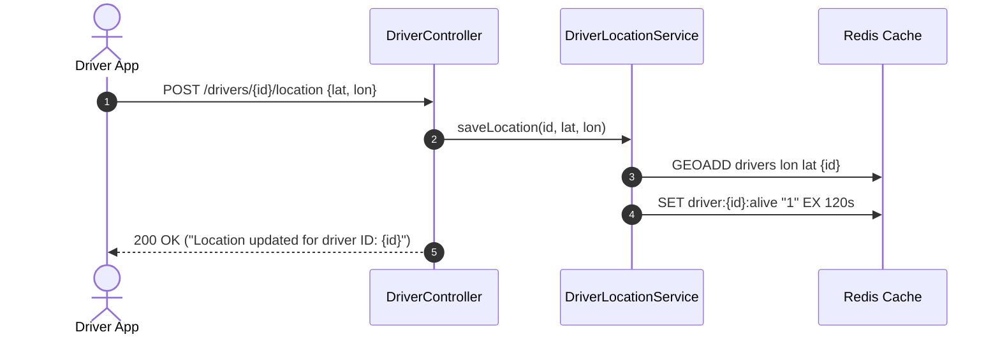
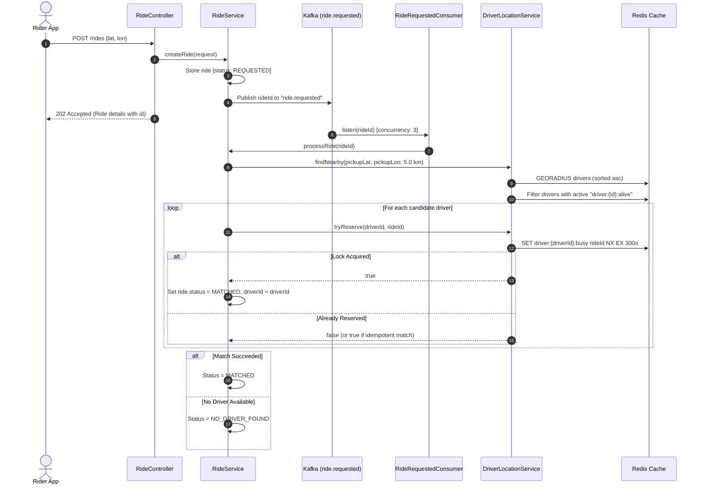
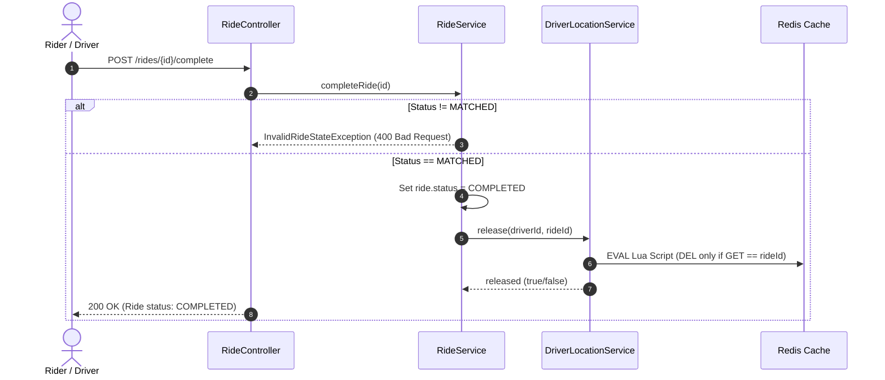
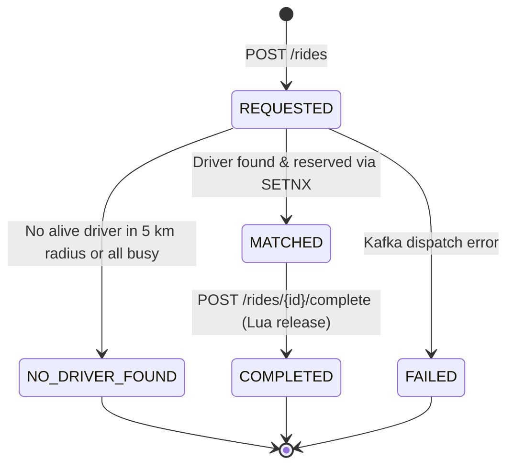

# 🚗 Voyage — Distributed Real-Time Ride Matching Service

[](https://openjdk.org/)
[](https://spring.io/projects/spring-boot)
[](https://kafka.apache.org/)
[](https://redis.io/)
[](https://maven.apache.org/)

**Voyage** is a high-throughput, event-driven ride-matching microservice engineered with **Spring Boot 4**, **Apache Kafka**, and **Redis**. It is modeled after core backend architectures found in modern ride-hailing services (e.g., Uber, Lyft, Grab), featuring geospatial driver discovery, heartbeat-based driver liveness, distributed driver reservation locks, atomic Lua-based driver release, and asynchronous event ingestion with partitioned consumer concurrency.

---

## 📑 Table of Contents

- [Key Architectural Highlights](#-key-architectural-highlights)
- [System Architecture & Flows](#-system-architecture--flows)
  - [1. Driver Location & Liveness Heartbeat](#1-driver-location--liveness-heartbeat)
  - [2. Asynchronous Ride Matching Flow](#2-asynchronous-ride-matching-flow)
  - [3. Ride Completion & Safe Driver Release](#3-ride-completion--safe-driver-release)
- [Technology Stack](#-technology-stack)
- [Project Directory Structure](#-project-directory-structure)
- [REST API Reference](#-rest-api-reference)
  - [Driver Endpoints](#driver-endpoints)
  - [Ride Endpoints](#ride-endpoints)
- [Redis Data Structures & Distributed Locking](#-redis-data-structures--distributed-locking)
  - [Key Architecture](#key-architecture)
  - [Distributed Reservation (SETNX)](#distributed-reservation-setnx)
  - [Atomic Release via Lua Script](#atomic-release-via-lua-script)
  - [Idempotent Redelivery Protection](#idempotent-redelivery-protection)
- [Kafka Event Pipeline Configuration](#-kafka-event-pipeline-configuration)
- [Ride Lifecycle & State Machine](#-ride-lifecycle--state-machine)
- [Concurrency & Integration Testing](#-concurrency--integration-testing)
- [Getting Started](#-getting-started)
  - [Prerequisites](#prerequisites)
  - [Environment Configuration](#environment-configuration)
  - [Running the Application](#running-the-application)
  - [Running the Test Suite](#running-the-test-suite)

---

## ⚡ Key Architectural Highlights

- **Spatial Indexing with Redis Geospatial**: Uses Redis Geospatial sorted sets (`GEOADD`, `GEOPOSITION`, `GEORADIUS`) to index driver locations and retrieve candidate drivers within radius constraints with sub-millisecond query performance.
- **Heartbeat-Driven Driver Liveness**: Driver coordinate updates establish an ephemeral heartbeat key (`driver:{id}:alive`) with an automatic 2-minute TTL. The matching engine dynamically filters out stale or offline drivers.
- **Decoupled Asynchronous Ingestion via Apache Kafka**: Ride requests return HTTP `202 Accepted` immediately upon creation and publish to a partitioned `ride.requested` Kafka topic, shielding API callers from spatial lookup latency.
- **Multi-Threaded Consumer Concurrency**: Kafka consumers process rides concurrently across topic partitions using Spring Kafka's multi-threaded listener containers.
- **Distributed Lock with TTL**: Prevents double-booking where multiple concurrent rides vie for the nearest driver using Redis `SETNX` (`setIfAbsent`) with a 5-minute safety TTL.
- **Atomic Lock Release via Lua Script**: Releases driver locks safely by matching the allocated `rideId` against the lock holder using an atomic Redis Lua script, eliminating race conditions and preventing accidental release of reassigned locks.
- **Idempotency Safeguard**: Built-in verification guarantees that duplicate Kafka message deliveries or retries for the same `rideId` do not reject already reserved drivers.
- **Haversine Distance Metric**: `GeoUtils` utility implementing Earth curvature Great-Circle distance calculations (radius 6,371 km).

---

## 🏗 System Architecture & Flows

### 1. Driver Location & Liveness Heartbeat

Drivers continuously report their coordinates. The service stores the spatial coordinates in the `drivers` GeoSet and refreshes an alive TTL key.



### 2. Asynchronous Ride Matching Flow

Riders submit a pickup coordinate. The request is persisted in memory, dispatched to Kafka, and matched asynchronously.



### 3. Ride Completion & Safe Driver Release

When a ride completes, the driver lock is atomically released via a Redis Lua script.



---

## 🛠 Technology Stack

| Component | Technology | Version / Specification | Details |
| :--- | :--- | :--- | :--- |
| **Language** | Java | OpenJDK 21 | Modern Java features (records, patterns, concurrency) |
| **Framework** | Spring Boot | 4.1.1 | Spring MVC, Spring Kafka, Spring Data Redis |
| **Event Broker** | Apache Kafka | 3.x+ compatible | Topic `ride.requested`, 3 partitions, consumer concurrency 3 |
| **In-Memory Store** | Redis | 6.x / 7.x compatible | Geospatial indexes, key TTLs, Lua scripting engine |
| **Client / Redis Template** | Spring Data Redis | Default Lettuce/Jedis | `StringRedisTemplate` with custom commands & Lua execution |
| **Utilities & Sugar** | Project Lombok | Runtime Optional | `@Getter`, `@Setter`, `@RequiredArgsConstructor`, `@Slf4j` |
| **Build & Dependency Tool** | Apache Maven | 3.9+ | Managed with Maven Wrapper (`mvnw` / `mvnw.cmd`) |
| **Testing** | JUnit 5 & Awaitility | Standard | Multi-threaded concurrency testing & async assertions |

---

## 📁 Project Directory Structure

```
voyage/
├── .mvn/
│   └── wrapper/
│       └── maven-wrapper.properties
├── src/
│   ├── main/
│   │   ├── java/
│   │   │   └── com/
│   │   │       └── akash/
│   │   │           └── voyage/
│   │   │               ├── VoyageApplication.java              # Main Spring Boot Application Entrypoint
│   │   │               ├── component/
│   │   │               │   └── RideRequestedConsumer.java      # Kafka listener consuming "ride.requested" events
│   │   │               ├── config/
│   │   │               │   └── KafkaConfig.java                 # Kafka Topic definition ("ride.requested", 3 partitions)
│   │   │               ├── controller/
│   │   │               │   ├── DriverController.java            # REST controller for driver positions & nearby queries
│   │   │               │   └── RideController.java              # REST controller for booking, status, and completion
│   │   │               ├── dto/
│   │   │               │   ├── NearestDriverResponse.java       # DTO representing driver id and distance in km
│   │   │               │   └── RideRequest.java                 # DTO capturing requested pickup coordinates
│   │   │               ├── enums/
│   │   │               │   └── RideStatus.java                  # Enum: REQUESTED, MATCHED, NO_DRIVER_FOUND, COMPLETED, FAILED
│   │   │               ├── exception/
│   │   │               │   ├── InvalidRideStateException.java   # HTTP 400 when completing an un-matched ride
│   │   │               │   └── RideNotFoundException.java       # HTTP 404 when requested ride ID does not exist
│   │   │               ├── model/
│   │   │               │   ├── Location.java                    # Model encapsulating latitude & longitude
│   │   │               │   └── Ride.java                        # Domain model with volatile thread-safe fields
│   │   │               ├── service/
│   │   │               │   ├── DriverLocationService.java       # Redis Geo logic, alive heartbeats, SETNX lock & Lua release
│   │   │               │   └── RideService.java                 # Core ride creation, Kafka publishing, and matching logic
│   │   │               └── utils/
│   │   │                   └── GeoUtils.java                    # Haversine distance calculation formula
│   │   └── resources/
│   │       └── application.yaml                                 # Spring configuration for Redis & Kafka
│   └── test/
│       └── java/
│           └── com/
│               └── akash/
│                   └── voyage/
│                       ├── VoyageApplicationTests.java          # Spring context load test
│                       └── service/
│                           └── RideConcurrencyTest.java         # 1000-thread race tests, idempotent matching & Lua tests
├── .gitattributes
├── .gitignore                                                   # Production-ready gitignore rules
├── HELP.md                                                      # Spring Boot generated starter help reference
├── mvnw                                                         # Unix Maven Wrapper script
├── mvnw.cmd                                                     # Windows Maven Wrapper script
├── pom.xml                                                      # Project Object Model dependencies & build definitions
└── README.md                                                    # Project documentation
```

---

## 📡 REST API Reference

### Driver Endpoints

#### 1. Update Driver Location & Heartbeat
Stores driver position in Redis geospatial index and updates their 2-minute liveness key.

- **URL**: `/drivers/{id}/location`
- **Method**: `POST`
- **Path Variable**: `id` (Integer) — Unique driver identifier
- **Request Body**:
  ```json
  {
    "latitude": 40.7128,
    "longitude": -74.0060
  }
  ```
- **Validation**:
  - `latitude` must be between `-85.05` and `+85.05`
  - `longitude` must be between `-180.0` and `+180.0`
- **Responses**:
  - `200 OK`: `"Location updated for driver ID: 1"`
  - `400 Bad Request`: `"Invalid location data"`

---

#### 2. Get Driver Location
Retrieves the current cached coordinates of a specific driver.

- **URL**: `/drivers/{id}/location`
- **Method**: `GET`
- **Path Variable**: `id` (Integer) — Unique driver identifier
- **Responses**:
  - `200 OK`:
    ```json
    {
      "latitude": 40.7128,
      "longitude": -74.0060
    }
    ```
  - `404 Not Found`: Driver location is not present in Redis.

---

#### 3. Find Nearby Active Drivers
Finds all active (alive) drivers within a specified radial distance, ordered closest to farthest.

- **URL**: `/drivers/nearby`
- **Method**: `GET`
- **Query Parameters**:
  - `lat` (Double, Required): Center latitude (between `-85.05` and `85.05`)
  - `lon` (Double, Required): Center longitude (between `-180.0` and `180.0`)
  - `radiusKm` (Double, Required): Search radius in kilometers (must be `> 0`)
- **Responses**:
  - `200 OK`:
    ```json
    [
      {
        "id": 101,
        "distance": 0.45
      },
      {
        "id": 204,
        "distance": 1.82
      }
    ]
    ```
  - `400 Bad Request`: Invalid coordinate or radius parameters.

---

### Ride Endpoints

#### 4. Request a New Ride
Creates a ride, persists it into in-memory state, and publishes the request event to Kafka.

- **URL**: `/rides`
- **Method**: `POST`
- **Request Body**:
  ```json
  {
    "latitude": 40.7128,
    "longitude": -74.0060
  }
  ```
- **Responses**:
  - `202 Accepted`:
    ```json
    {
      "id": "c71a39f0-2810-482a-8ef7-476fef74ec9b",
      "driverId": null,
      "pickupLatitude": 40.7128,
      "pickupLongitude": -74.0060,
      "status": "REQUESTED"
    }
    ```
  - `400 Bad Request`: Null or invalid coordinates.

---

#### 5. Get Ride Status
Queries the current state of a ride by its ID.

- **URL**: `/rides/{id}`
- **Method**: `GET`
- **Path Variable**: `id` (String) — UUID of the ride
- **Responses**:
  - `200 OK`:
    ```json
    {
      "id": "c71a39f0-2810-482a-8ef7-476fef74ec9b",
      "driverId": 101,
      "pickupLatitude": 40.7128,
      "pickupLongitude": -74.0060,
      "status": "MATCHED"
    }
    ```
  - `404 Not Found`: No ride exists with the given ID.

---

#### 6. Complete a Ride
Completes an active ride and atomically releases the reserved driver lock.

- **URL**: `/rides/{id}/complete`
- **Method**: `POST`
- **Path Variable**: `id` (String) — UUID of the ride
- **Responses**:
  - `200 OK`:
    ```json
    {
      "id": "c71a39f0-2810-482a-8ef7-476fef74ec9b",
      "driverId": 101,
      "pickupLatitude": 40.7128,
      "pickupLongitude": -74.0060,
      "status": "COMPLETED"
    }
    ```
  - `400 Bad Request`: Ride is not currently in `MATCHED` state (`InvalidRideStateException`).
  - `404 Not Found`: Ride ID does not exist (`RideNotFoundException`).

---

## 🔒 Redis Data Structures & Distributed Locking

### Key Architecture

| Redis Key Pattern | Type | Expiration (TTL) | Purpose |
| :--- | :--- | :--- | :--- |
| `drivers` | `GEO / ZSET` | None | Stores member driver IDs with longitude and latitude. |
| `driver:{id}:alive` | `String` | 2 minutes (`Duration.ofMinutes(2)`) | Heartbeat sentinel flag (`"1"`). Only drivers with this key are considered available. |
| `driver:{id}:busy` | `String` | 5 minutes (`Duration.ofMinutes(5)`) | Distributed mutex holding the reserving `rideId`. |

### Distributed Reservation (SETNX)

To ensure no two rides match with the same driver concurrently, reservation is acquired via `SETNX`:

```java
Boolean success = redisTemplate.opsForValue().setIfAbsent(busyKey(driverId), rideId, Duration.ofMinutes(5));
```

### Atomic Release via Lua Script

Standard `DEL` commands risk deleting a lock that has expired and been acquired by another ride. Voyage executes an atomic Redis Lua script:

```lua
if redis.call('Get', KEYS[1]) == ARGV[1] then
    return redis.call('DEL', KEYS[1])
else
    return 0
end
```

This guarantees that `driver:{id}:busy` is deleted **if and only if** its value matches the completing `rideId`.

### Idempotent Redelivery Protection

If Kafka redelivers a `ride.requested` event or a consumer retries, `tryReserve()` verifies whether the existing lock holder is already the incoming `rideId`:

```java
if (Boolean.TRUE.equals(success)) {
    return true;
} else {
    String current = redisTemplate.opsForValue().get(busyKey(driverId));
    return rideId.equals(current);
}
```

This ensures idempotent event handling without spurious failure transitions.

---

## 📬 Kafka Event Pipeline Configuration

The messaging layer is configured in `application.yaml` and initialized via `KafkaConfig`:

```yaml
spring:
  kafka:
    bootstrap-servers:
      - localhost:9092
    consumer:
      group-id: matching-service
      auto-offset-reset: earliest
      key-deserializer: org.apache.kafka.common.serialization.StringDeserializer
      value-deserializer: org.apache.kafka.common.serialization.StringDeserializer
    producer:
      key-serializer: org.apache.kafka.common.serialization.StringSerializer
      value-serializer: org.apache.kafka.common.serialization.StringSerializer
```

- **Topic**: `ride.requested`
- **Partitions**: `3`
- **Replicas**: `1`
- **Consumer Concurrency**: `3` concurrent thread listeners configured via `@KafkaListener(concurrency = "3")`.

---

## 🔄 Ride Lifecycle & State Machine



- `REQUESTED`: Initial state after persistence in `ConcurrentHashMap`.
- `MATCHED`: A nearby, alive driver was locked (`SETNX`) successfully.
- `NO_DRIVER_FOUND`: Either no alive drivers exist within a 5 km radius or all candidates are already reserved.
- `COMPLETED`: The ride reached its destination; the driver reservation lock is released.
- `FAILED`: Kafka publishing failed during ride creation.

---

## 🧪 Concurrency & Integration Testing

The test suite in [`RideConcurrencyTest.java`](file:///c:/6th%20sem/Microservice%20and%20Other/voyage/src/test/java/com/akash/voyage/service/RideConcurrencyTest.java) executes high-concurrency race condition simulations:

1. **1,000 Concurrent Threads Racing for 1 Driver**:
   - Uses `CountDownLatch` as a starting gate to release 1,000 threads simultaneously.
   - Asserts that **exactly 1 thread** succeeds in calling `tryReserve()` while the remaining 999 are rejected.
2. **1,000 Concurrent Ride Requests via Kafka**:
   - Spawns 1,000 concurrent ride requests targeting the same geographic area.
   - Waits via `Awaitility` for asynchronous Kafka processing.
   - Asserts that exactly **1 ride is MATCHED** and **999 rides transition to NO_DRIVER_FOUND**.
3. **Safe Lock Release Verification**:
   - Verifies that releasing `driver:9001:busy` with the wrong `rideId` leaves the lock intact.
   - Verifies that releasing with the correct `rideId` clears the lock.
   - Verifies that repeat release invocations return `false`.
4. **Idempotent Kafka Redelivery**:
   - Simulates redelivery of a message for an already matched ride.
   - Asserts that the second reservation succeeds idempotently and does not corrupt status or driver assignment.

---

## 🚀 Getting Started

### Prerequisites

- **Java Development Kit (JDK)**: Version 21 or later
- **Redis Server**: Running locally on `localhost:6379`
- **Apache Kafka**: Running locally on `localhost:9092` (with Zookeeper or KRaft)

You can launch Redis and Kafka quickly using Docker:

```bash
# Start Redis
docker run -d --name voyage-redis -p 6379:6379 redis:alpine

# Start Kafka with KRaft (single-node)
docker run -d --name voyage-kafka -p 9092:9092 \
  -e KAFKA_NODE_ID=1 \
  -e KAFKA_PROCESS_ROLES=broker,controller \
  -e KAFKA_LISTENERS=PLAINTEXT://0.0.0.0:9092,CONTROLLER://0.0.0.0:9093 \
  -e KAFKA_ADVERTISED_LISTENERS=PLAINTEXT://localhost:9092 \
  -e KAFKA_CONTROLLER_LISTENER_NAMES=CONTROLLER \
  -e KAFKA_LISTENER_SECURITY_PROTOCOL_MAP=CONTROLLER:PLAINTEXT,PLAINTEXT:PLAINTEXT \
  -e KAFKA_CONTROLLER_QUORUM_VOTERS=1@localhost:9093 \
  -e KAFKA_OFFSETS_TOPIC_REPLICATION_FACTOR=1 \
  apache/kafka:latest
```

### Environment Configuration

Application settings are located at [`src/main/resources/application.yaml`](file:///c:/6th%20sem/Microservice%20and%20Other/voyage/src/main/resources/application.yaml). You can customize ports and connection strings for production or remote clusters as needed.

### Running the Application

Using the Maven Wrapper:

```bash
# Windows
.\mvnw.cmd spring-boot:run

# Linux / macOS
./mvnw spring-boot:run
```

The application will start on `http://localhost:8080`.

### Running the Test Suite

To run all unit, integration, and concurrency tests:

```bash
# Windows
.\mvnw.cmd test

# Linux / macOS
./mvnw test
```

---

## 👤 Author

Developed by **Akash Singh**. Built for high-concurrency distributed ride matching with Spring Boot, Redis Geospatial, and Apache Kafka.
