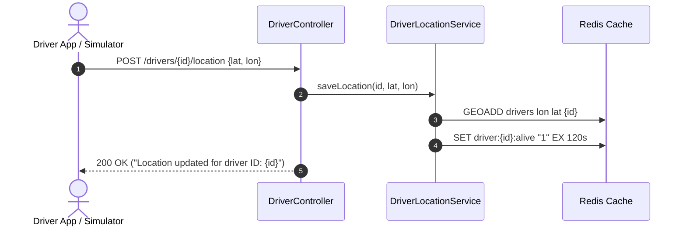
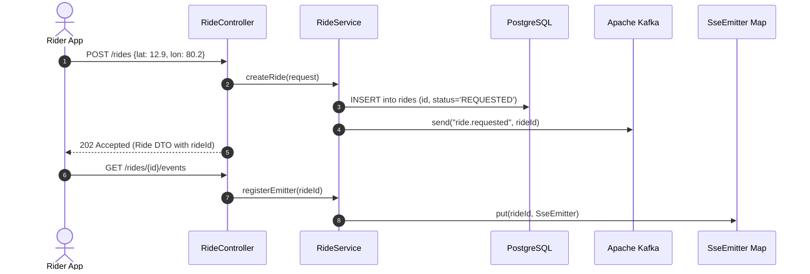
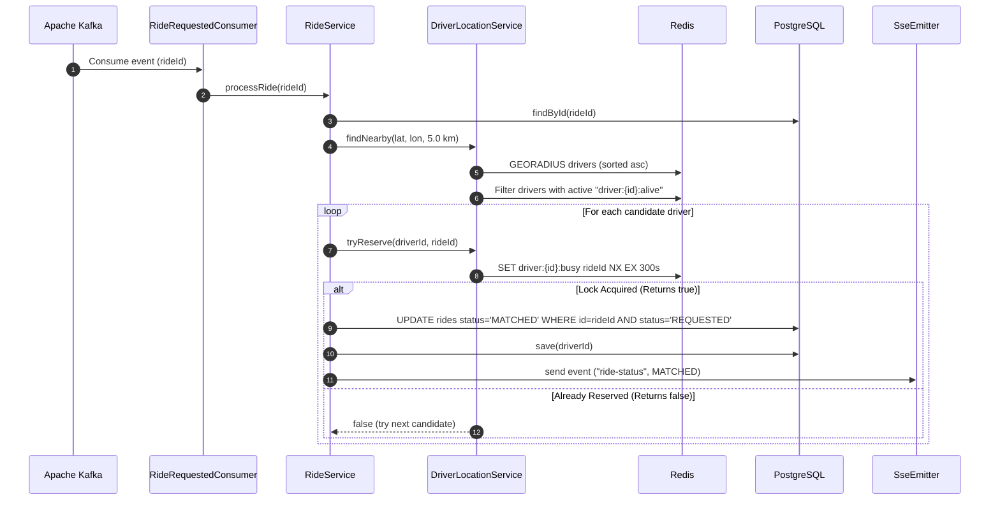
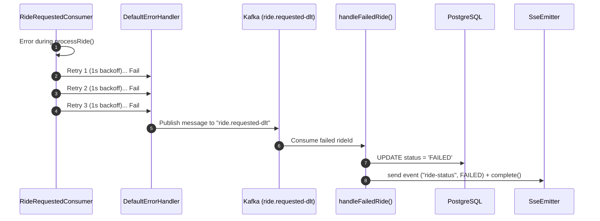
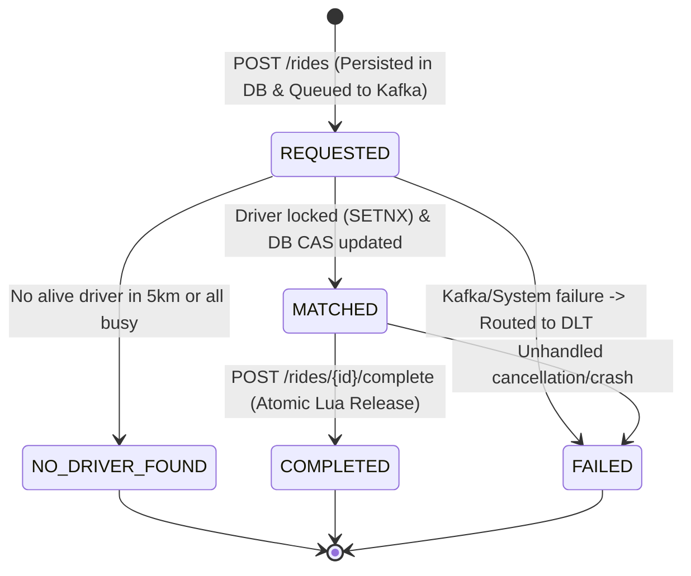

# 01 — System Architecture & System Design

---

## 🎯 1. High-Level Problem Statement

In ride-hailing applications like Uber, Ola, or Lyft, matching a rider with an available driver is not as simple as querying a database table. Why?
1. **High Concurrency**: Thousands of riders request rides at the exact same second in the same neighborhood (e.g., concert ending or airport terminal rush).
2. **Moving Supply**: Thousands of drivers update their GPS coordinates every few seconds.
3. **The Double-Booking Problem**: Multiple riders might be closest to the *same* driver. If 20 riders request a ride simultaneously, only one driver should be allocated, and 19 others should be evaluated for other drivers without collision.
4. **Latency & Mobile Battery**: A rider cannot sit staring at a loading spinner for 15 seconds while a server synchronously loops through nearby drivers. The server must accept the request immediately (`HTTP 202 Accepted`), process the matching asynchronously in the background, and push the result back in real time.

**Voyage** is engineered to solve these exact distributed systems challenges cleanly and reliably.

---

## 🏗️ 2. Core Architectural Pillars

Voyage follows a **Polyglot Persistence & Event-Driven Microservice** pattern:

| Component | Role in Voyage | Why This Technology? |
| :--- | :--- | :--- |
| **Spring Boot 4 (Java 21)** | Core application framework | High developer velocity, non-blocking virtual threads/reactive support, mature Kafka & Redis integrations. |
| **PostgreSQL** | Source of truth & durable storage | ACID guarantees, historical record keeping, transactions, and conditional Compare-And-Set (CAS) state updates. |
| **Redis** | Spatial index + Distributed locks + Heartbeats | Sub-millisecond latency for fast geospatial radius searches (`GEORADIUS`), in-memory mutex locks (`SETNX`), and ephemeral TTL keys. |
| **Apache Kafka** | Asynchronous message broker | Decouples HTTP ingestion from heavy matching logic. Ensures traffic spikes are buffered safely and processed with partitioned concurrency. |
| **Server-Sent Events (SSE)** | Real-time push updates | Unidirectional lightweight streaming from server to client over HTTP. Eliminates wasteful client polling. |

---

## 🔄 3. End-to-End System Flows & Sequence Diagrams

### Flow 1: Driver Heartbeat & Spatial Indexing
Every 2 seconds, drivers report their live coordinates.
1. `DriverController` receives `POST /drivers/{id}/location`.
2. `DriverLocationService` calls Redis `opsForGeo().add("drivers", point, id)`.
3. It also refreshes a heartbeat sentinel key: `SET driver:{id}:alive "1" EX 120`.
4. If a driver drops off the grid or loses network connectivity, their `alive` key expires after 2 minutes. Even though their location remains in the geo set, the matching engine automatically filters them out as inactive!



---

### Flow 2: Asynchronous Ride Request & Ingestion
When a rider taps "Request Ride":
1. Rider sends `POST /rides` with pickup coordinates.
2. `RideController` validates coordinates and invokes `RideService.createRide(request)`.
3. `RideService` creates a `Ride` record in PostgreSQL with status `REQUESTED`.
4. `RideService` publishes the `rideId` to the Kafka topic `ride.requested`.
5. The API returns `202 Accepted` immediately (typically < 10 ms). The client gets its `rideId` without waiting for driver matching.
6. The rider connects to `/rides/{id}/events` via Server-Sent Events (SSE) to listen for match updates.



---

### Flow 3: Kafka Consumption, Matching & Distributed Locking
In the background, Kafka consumers pick up ride requests:
1. `RideRequestedConsumer` listens on `ride.requested` with 3 concurrent worker threads.
2. It passes `rideId` to `RideService.processRide(rideId)`.
3. `RideService` queries Redis for alive drivers within 5 km: `driverLocationService.findNearby(lat, lon, 5.0)`.
4. Redis returns candidates sorted closest-first.
5. For each candidate, `RideService` attempts a distributed lock: `driverLocationService.tryReserve(driverId, rideId)` using Redis `SETNX driver:{id}:busy rideId EX 300`.
6. **If acquired**:
   - `RideService` executes an atomic conditional update on PostgreSQL:
     ```sql
     UPDATE rides SET status = 'MATCHED' WHERE id = :rideId AND status = 'REQUESTED'
     ```
   - Only the winning thread sets the driver ID and saves the entity.
   - It notifies the client via `SseEmitter` and closes the stream.
7. **If no driver is found or all candidates are locked**:
   - Ride status is updated to `NO_DRIVER_FOUND` in PostgreSQL.
   - Client is notified via SSE.



---

### Flow 4: Ride Completion & Atomic Safe Lock Release
When the trip concludes:
1. `POST /rides/{id}/complete` is received.
2. `RideService` verifies the ride is currently `MATCHED` (otherwise throws `InvalidRideStateException`).
3. `Ride` status is updated to `COMPLETED` in PostgreSQL.
4. `DriverLocationService.release(driverId, rideId)` executes an atomic Lua script:
   ```lua
   if redis.call('GET', KEYS[1]) == ARGV[1] then
       return redis.call('DEL', KEYS[1])
   else
       return 0
   end
   ```
5. **Why Lua?** Plain `DEL` is vulnerable to race conditions if a lock expired and was acquired by a *different* ride. The Lua script ensures the key is deleted **only if the current value matches our rideId**.

---

### Flow 5: Dead Letter Topic (DLT) & Fault Tolerance
What happens if the database is down or matching throws an unhandled exception repeatedly?
1. Spring Kafka's `DefaultErrorHandler` intercepts the failure.
2. It retries 3 times with a 1-second fixed backoff.
3. If all retries fail, `DeadLetterPublishingRecoverer` sends the message to `ride.requested-dlt`.
4. `RideRequestedConsumer.handleFailedRide(rideId)` consumes from the DLT, updates the ride status in PostgreSQL to `FAILED`, and notifies the waiting client via SSE so their screen does not freeze.



---

## 🚦 4. The Ride Lifecycle State Machine

A ride in Voyage moves through strict, deterministic state transitions:



| State | Trigger | Next Allowed States |
| :--- | :--- | :--- |
| `REQUESTED` | Rider sends `POST /rides` | `MATCHED`, `NO_DRIVER_FOUND`, `FAILED` |
| `MATCHED` | Kafka consumer finds available driver & acquires Redis lock | `COMPLETED`, `FAILED` |
| `NO_DRIVER_FOUND` | No alive drivers within 5 km or all candidates locked | Terminal state |
| `COMPLETED` | Rider/Driver hits `POST /rides/{id}/complete` | Terminal state |
| `FAILED` | Unrecoverable error sent to DLT | Terminal state |

---

## ⚡ 5. Why Asynchronous (Kafka + SSE) vs Synchronous HTTP?

| Metric / Characteristic | Synchronous Approach (No Kafka/SSE) | Voyage's Asynchronous Approach |
| :--- | :--- | :--- |
| **API Response Latency** | 300 ms – 3,000 ms (waits for geo search, lock trials) | **< 15 ms** (returns `202 Accepted` immediately) |
| **Server Thread Starvation** | High: Tomcat threads blocked waiting on spatial queries & locks | **None**: Worker threads release HTTP connections instantly |
| **Handling Traffic Spikes** | Crashes with HTTP 504 Gateway Timeout | **Smooth**: Kafka buffers millions of events safely in topics |
| **Client Experience** | Hanging loading spinner, mobile timeout errors | **Real-time**: Immediate response, live push via SSE |
